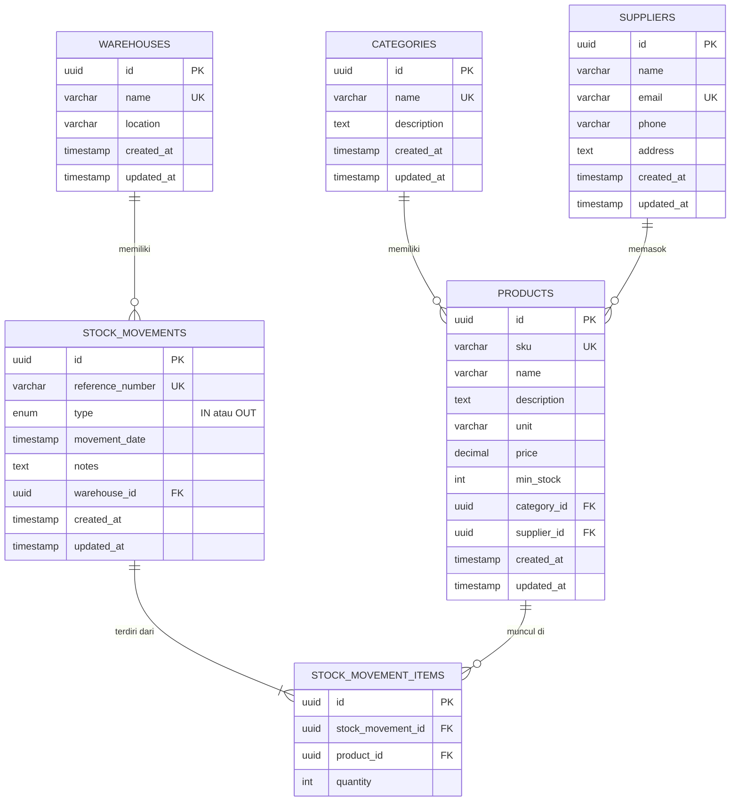

# ERD (Entity Relationship Diagram)

Gambar: [`erd.png`](./erd.png) &nbsp;|&nbsp; Sumber diagram: [`erd.mmd`](./erd.mmd)

## Daftar relasi

| # | Relasi | Jenis | Foreign key | Perilaku saat induk dihapus |
|---|--------|-------|-------------|-----------------------------|
| 1 | Category → Product | One-to-Many | `products.category_id` | Ditolak (409) bila masih punya produk |
| 2 | Supplier → Product | One-to-Many | `products.supplier_id` | Ditolak (409) bila masih memasok produk |
| 3 | Warehouse → StockMovement | One-to-Many | `stock_movements.warehouse_id` | Ditolak (409) bila sudah punya transaksi |
| 4 | StockMovement → StockMovementItem | One-to-Many | `stock_movement_items.stock_movement_id` | Detail ikut terhapus (`ON DELETE CASCADE`) |
| 5 | Product → StockMovementItem | One-to-Many | `stock_movement_items.product_id` | Ditolak (409) bila sudah dipakai di transaksi |

`stock_movement_items` adalah **tabel penghubung** antara `products` dan `stock_movements`.
Secara logis, hubungan Product dan StockMovement adalah **many-to-many** (satu produk ada di banyak transaksi,
satu transaksi berisi banyak produk) dan tabel penghubung ini membawa atribut tambahan: `quantity`.

Constraint tambahan:
- `UNIQUE (stock_movement_id, product_id)` pada `stock_movement_items`: satu produk hanya muncul sekali per transaksi.
- `UNIQUE` pada `categories.name`, `suppliers.email`, `warehouses.name`, `products.sku`, `stock_movements.reference_number`.
